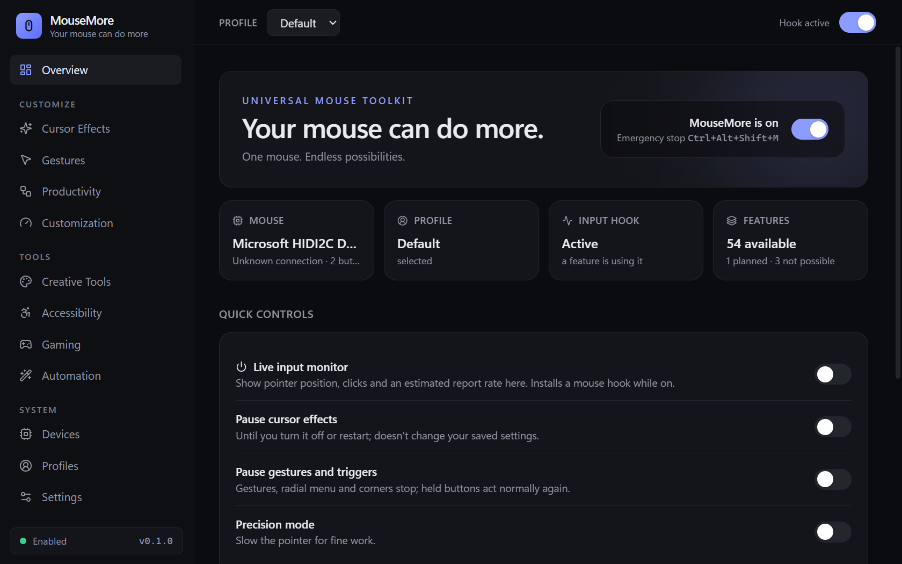
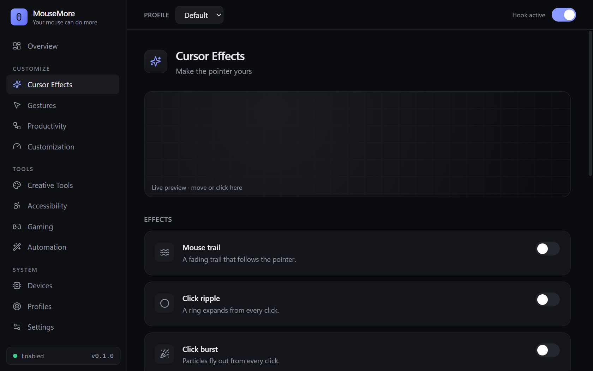
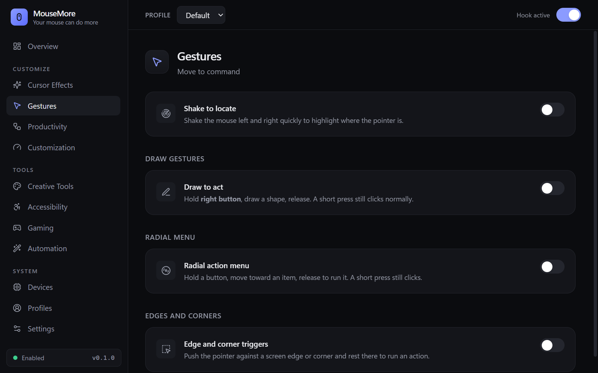

# MouseMore

**Your mouse can do more.** *One mouse. Endless possibilities.*

MouseMore is a free, open-source desktop utility that unlocks more of an ordinary mouse: cursor effects, gestures, a radial menu, button remapping, scroll control, per-app profiles, screen tools and automation, working system-wide. It is local-first: no account, no telemetry, no network access.

> **Status: 0.1 pre-release (Windows 10/11).** Every feature listed below is implemented. Automated tests cover the logic; interactive behaviour (gestures, overlay visuals, tray) still needs wider real-world testing. See [docs/TESTING.md](docs/TESTING.md) and the honest per-feature status in [docs/COMPATIBILITY.md](docs/COMPATIBILITY.md).



<p>
  
  
</p>

## Why

Mouse tools are usually tied to one vendor's hardware, need an account, or run heavy background processes. MouseMore works with any mouse Windows can see, keeps everything on your machine, and shows you every hook, overlay and automation it uses. Anything it cannot do, it says so instead of pretending.

## Features

| Area | What you get |
|---|---|
| **Cursor effects** | Trail, click ripple, click burst, glow, spotlight; solid or rainbow color, intensity, speed; live preview; pauses in full-screen apps |
| **Gestures** | Draw-to-act (any button), record your own strokes, shake to locate, radial menu, edge/corner triggers, double/triple-click bindings |
| **Productivity** | Window snap/min/max/close, app switching, Task view, screenshot, search selected text, multi-monitor jumps, launcher (radial menu), Windows clipboard history and Game Bar recording shortcuts |
| **Customization** | Remap middle/side buttons to any action, scroll speed / reverse / hold-key horizontal scroll, pointer speed, precision mode, double-click time |
| **Creative tools** | Draw on screen, pixel ruler, laser pointer, spotlight/click highlights |
| **Accessibility** | Large high-contrast pointer ring, click visualization, optional click sound, pointer locator, slow pointer |
| **Gaming** | Per-game quiet profiles that switch automatically, full-screen pause, side-button shortcuts, report-rate estimate |
| **Automation** | Macros with delays, per-app bindings, **emergency stop** (`Ctrl+Alt+Shift+M`), optional plugins |
| **Devices** | Real device list (name, buttons, wheel, bus, VID/PID), runtime compatibility checker |
| **Profiles / personalization** | Multiple profiles, per-app auto-switching, ready-made presets, dark/light/system themes, import/export/reset, tray, optional start with Windows |

**Not possible from software, and not claimed:** changing a mouse's hardware DPI or polling rate, reading battery level from generic mice, per-physical-mouse profiles (the OS hook can't tell mice apart). The magnifier opens Windows Magnifier; clipboard history and recording open Windows' own tools. See the [compatibility matrix](docs/COMPATIBILITY.md).

## Safety by design

- **Everything is opt-in and visible.** Defaults turn every hook, overlay and automation *off*. A hook is installed only while a feature that needs it is on.
- **Emergency stop:** `Ctrl+Alt+Shift+M` (or the tray menu) disables everything and halts running macros. The global switch also restores your Windows pointer speed and double-click time.
- **You can't lock yourself out:** the left button is never trapped or remapped. A held-back gesture/radial button is replayed as a normal click when you don't draw, and clicks are never lost if settings change mid-press.
- **Imports are reviewed:** importing settings first lists every program or link the file could launch.
- **No admin rights.** Windows does not let a normal app see or act on *elevated* windows; MouseMore doesn't bypass that.

## Install

Releases are not published yet. Build from source:

**Prerequisites (Windows):** [Node.js](https://nodejs.org) 20+, [Rust](https://rustup.rs) (MSVC), Visual Studio Build Tools with **Desktop development with C++**, WebView2 (preinstalled on Windows 11).

```powershell
npm install
npm run dev                          # development window
npm run build                        # NSIS installer (per-user, no admin) in target/release/bundle/nsis
./scripts/package-portable.ps1       # portable ZIP in dist-portable/
```

**Portable edition:** extract the ZIP and run `mousemore.exe`. The `portable.flag` file beside it keeps all data in a `data` folder next to the executable; delete the flag to use your user profile instead. Portable and installed editions have identical features.

## Plugins

Drop a folder with a `plugin.json` into the plugins folder (Settings shows its path):

```json
{ "id": "my-tools", "name": "My tools", "version": "1.0",
  "actions": [ { "id": "notes", "label": "Open notes", "run": "notes.cmd" },
               { "id": "docs",  "label": "Open docs",  "run": "https://example.com/" } ] }
```

Actions may run files *inside the plugin folder* or open `https://` links, and only run when you bind them and enable the plugin.

## Project layout

```
apps/desktop/          Tauri app: React + TypeScript UI, overlay page, Rust shell (src-tauri)
core/mousemore-core/   Platform-independent Rust: settings, actions, gesture logic, presets, storage
docs/                  Architecture, roadmap, compatibility, manual test plan
scripts/               Packaging helpers
```
See [docs/ARCHITECTURE.md](docs/ARCHITECTURE.md).

## Contributing

Read [CONTRIBUTING.md](CONTRIBUTING.md) and the [Code of Conduct](CODE_OF_CONDUCT.md). Security issues: [SECURITY.md](SECURITY.md).

## License

[MIT](LICENSE)
